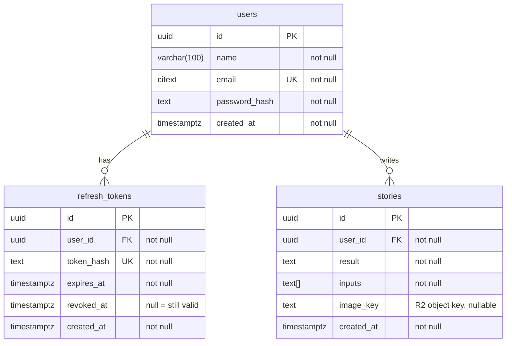

# StoryMixer Backend

ASP.NET Core Web API (Minimal APIs) targeting .NET 10.

## Prerequisites

- [.NET 10 SDK](https://dotnet.microsoft.com/download/dotnet/10.0)

## Project layout

```
StoryMixer.slnx
src/
  StoryMixer.Api/   # Web API project
```

## Database

PostgreSQL 17. Story images are stored in Cloudflare R2; `stories.image_key` holds the object key.



### Start the local database

Requires [Docker Desktop](https://www.docker.com/products/docker-desktop/).

```bash
docker compose up -d
```

Connection: host `localhost`, port `5432`, database/user/password `storymixer` (dev only). Stop with `docker compose down`; add `-v` to also wipe the data.

## Run locally

```bash
dotnet restore
dotnet run --project src/StoryMixer.Api
```

The API listens on `http://localhost:5263` by default. To use HTTPS (`https://localhost:7058`), trust the dev certificate once and run the `https` launch profile:

```bash
dotnet dev-certs https --trust
dotnet run --project src/StoryMixer.Api --launch-profile https
```

In the Development environment the OpenAPI document is served at `/openapi/v1.json`.

## Build

```bash
dotnet build
```
