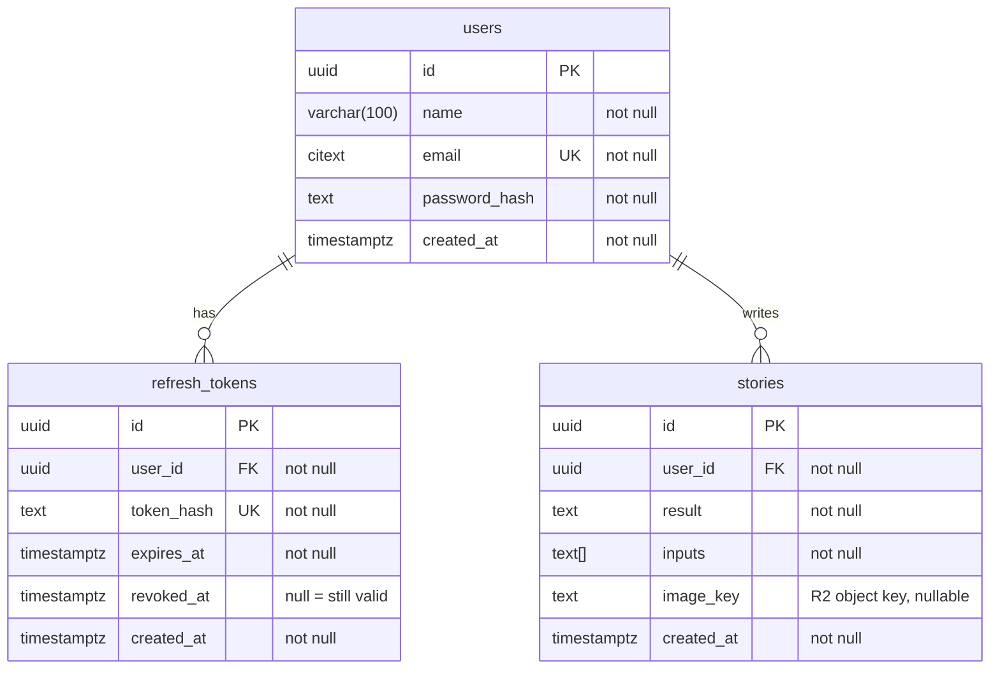

# StoryMixer Backend

ASP.NET Core Web API (Minimal APIs) targeting .NET 10.

## Prerequisites

- [.NET 10 SDK](https://dotnet.microsoft.com/download/dotnet/10.0)

## Project layout

Code is organized by feature: everything for one feature (endpoints, DTOs) lives in `Features/<Feature>/`.

```
StoryMixer.slnx
docker-compose.yml          # local Postgres
src/
  StoryMixer.Api/
    Program.cs              # app startup, wires up features
    Data/
      AppDbContext.cs       # EF Core database context
      Configurations/       # EF table/column setup per entity
      Migrations/           # generated by `dotnet ef`
    Entities/               # C# classes mapped to tables
    Features/
      Auth/                 # POST /auth/login, JWT token creation
      Health/               # GET /health/db
      Users/                # POST /users (sign up), GET /users/me
tests/
  StoryMixer.Api.Tests/     # xUnit tests, mirrors Features/ layout
```

## Test

```bash
dotnet test
```

Integration tests start their own throwaway Postgres container (Testcontainers), so Docker Desktop must be running. They never touch the dev database.

## Database

PostgreSQL 17. Story images are stored in Cloudflare R2; `stories.image_key` holds the object key.



### Start the local database

Requires [Docker Desktop](https://www.docker.com/products/docker-desktop/).

```bash
docker compose up -d
```

Connection: host `localhost`, port `5432`, database/user/password `storymixer` (dev only). Stop with `docker compose down`; add `-v` to also wipe the data.

### Migrations

Requires the EF Core tool: `dotnet tool install --global dotnet-ef`.

```bash
# Apply all pending migrations to the database
dotnet ef database update --project src/StoryMixer.Api

# After changing entities: generate a new migration, review it, then apply it
dotnet ef migrations add <Name> --project src/StoryMixer.Api --output-dir Data/Migrations
```

## Run locally

The JWT signing key is kept out of git in [user secrets](https://learn.microsoft.com/aspnet/core/security/app-secrets). Set it once:

```bash
dotnet user-secrets set "Jwt:Key" "$(openssl rand -base64 48)" --project src/StoryMixer.Api
```

```bash
dotnet restore
dotnet run --project src/StoryMixer.Api
```

The API listens on `http://localhost:5263` by default. To use HTTPS (`https://localhost:7058`), trust the dev certificate once and run the `https` launch profile:

```bash
dotnet dev-certs https --trust
dotnet run --project src/StoryMixer.Api --launch-profile https
```

In the Development environment:

- Swagger UI: `http://localhost:5263/swagger`, to try every endpoint from the browser
- Log in with `POST /auth/login`, copy `accessToken`, click **Authorize** and paste it to call protected endpoints like `GET /users/me`
- OpenAPI document: `/openapi/v1.json` (import this URL into Postman to get all endpoints as a collection)

## Build

```bash
dotnet build
```
